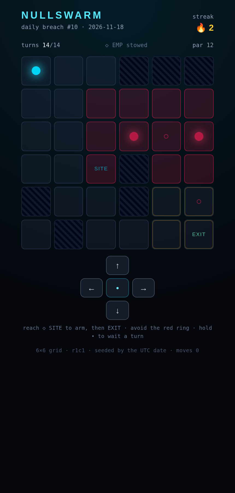

# NULLSWARM · Daily Breach

A daily stealth puzzle for Reddit, built with **Devvit Web** (React 19 + Hono)
for Reddit's Game of the Day Hackathon 2026.

Every UTC day at 13:00 a scheduler posts a new **Interactive Post**. The board is
generated from the date alone, so every operator on Reddit plays the identical
6×6 floor plan. You get **one run per day**: plant the EMP at the site, reach the
exit, and never step into a sentry's ring. Streaks, an in-post leaderboard and a
copy-paste result block keep the daily loop going.



## How to play

- You are the cyan operator in the top-left corner. The exit is the bottom-right.
- **◇ SITE** arms the EMP when you step on it; **EXIT** completes the breach — but
  only after the EMP is armed.
- **Red cells** are sentry rings: stepping into one ends the run.
- **Amber outlines** show where the rings will be after your next move, so you can
  plan around the patrol instead of guessing.
- You have 12–14 turns, and the daily `par` (the shortest safe line, found by
  exhaustive search) is displayed. Finishing closer to par scores more.
- Controls: arrow keys / WASD, `space` or `•` to hold position, or tap a
  neighbouring cell.

Score = `1000 − 70 × (turns − par)` (floor 100) `+ 15 × safe moves` `+ 150` for a
run that never enters a "tight" cell. One run per operator per day; the daily
leaderboard is a Redis sorted set scoped to the date.

## Daily loop & Reddit features

| Feature | Where |
| --- | --- |
| Deterministic daily board seeded by the UTC date | `src/shared/engine.ts` (`makeLevel`) |
| One attempt per day, server-authoritative replay | `POST /api/submit` re-simulates the move list |
| Streaks (reset after a missed day) | `nextStreak` + `ns:streak:{user}` |
| Daily leaderboard | Redis sorted set `ns:board:{date}` |
| Shareable result block (Wordle-style) | `shareText` + "Copy result" button |
| Comment hook — posts the result as the player | `POST /api/comment`, `reddit.submitComment({ runAs: 'USER' })` |
| Streak flair (3+ days) | `reddit.setUserFlair` |
| Automatic daily post at 13:00 UTC | `scheduler` in `devvit.json` → `/internal/scheduler/daily-post` |
| Mod menu: create today's post / peek at par | `devvit.json` menu items |
| Fast inline launch screen | `src/client/splash.tsx` (inline entrypoint) |

## Anti-cheat / determinism

The client plays locally for instant feedback, but the server never trusts it:
`POST /api/submit` rebuilds the level from the date, replays the submitted move
list with `simulate()`, and stores the outcome. A second submission for the same
day returns the stored result instead of a new one. `tests/engine.test.ts`
verifies 40 consecutive days are solvable and that the optimal line always
breaches.

## Reproduce locally

```bash
# 1. install
npm install

# 2. unit tests (deterministic levels, scoring, streaks, share text)
npm run test:unit

# 3. typecheck + lint + bundle
npm run test:types
npm run lint
npm run build

# 4. play it in a normal browser against a local stub of the Devvit endpoints
node tools/preview.mjs      # http://localhost:4173/game.html
                            # http://localhost:4173/splash.html
```

`tools/preview.mjs` is a development-only stub: it serves `dist/client` and fakes
`/api/init`, `/api/submit` and `/api/comment` with the real engine. It is not part
of the uploaded app.

## Deploy to Reddit

```bash
npm i -g devvit        # or use a local install
devvit login           # logs in through reddit.com
devvit upload          # creates/updates the app listing (developers.reddit.com/apps/nullswarm-daily)
devvit playtest r/<your-test-subreddit>   # install + hot reload on a private post
```

The app needs Redis enabled and the `SUBMIT_COMMENT` user action, both declared in
`devvit.json`. `devvit upload` only installs to subreddits under 200 members,
which is exactly what the hackathon asks for.

## Layout

```
devvit.json                 app config: entrypoints, menu, scheduler, permissions
src/shared/engine.ts        deterministic level generation, solver, simulation, scoring
src/shared/api.ts           request/response types shared by client and server
src/server/index.ts         Hono app (api + internal routes)
src/server/core/daily.ts    Redis keys, streaks, leaderboard, daily post creation
src/server/routes/          api, menu, scheduler, triggers
src/client/splash.tsx       inline launch screen
src/client/game.tsx         expanded game view (board, D-pad, result card)
src/client/components/Board.tsx
tests/engine.test.ts        engine tests (node:test)
tools/preview.mjs           local preview server (dev only)
docs/                       screenshots
```

## Credits

The IP, art direction and setting come from **NULLSWARM**, an original tactical
game owned by this workspace (also published as *Operation Protocol*). This post
is a daily, turn-based port of that universe: same EMP-planting objective, same
sentry-swarm fiction, rebuilt as a bite-sized puzzle that fits a Reddit post.

Scaffold derived from Reddit's `devvit-template-react` (BSD-3-Clause); game code
MIT — see `LICENSE`.
